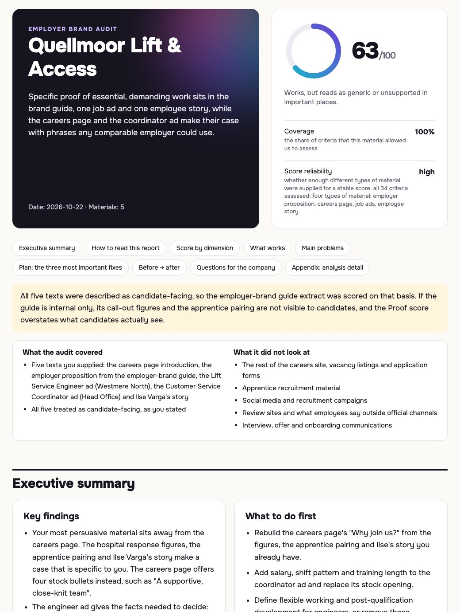

# Employer Brand Auditor

**Find out which of your employer-brand claims a candidate would actually believe.**

[](LICENSE)
[](CHANGELOG.md)
[](docs/INSTALL.md)

Employer Brand Auditor is a Claude Code plugin that audits careers pages, EVPs, job ads and employee stories through a candidate's eyes. It scores what your material **proves**, not what it promises. It shows where your copy sounds like everyone else's, tells you what to fix first, and hands you a **ready-to-share HTML report** that explains its own method.

**No evidence → no claim.** It never invents facts, figures, quotes or benchmarks. Where proof is missing, it says so.

## Install

```bash
claude plugin marketplace add denzjama/employer-brand-auditor
```

```bash
claude plugin install employer-brand-auditor@employer-brand-auditor
```

Start a new Claude Code session. Then paste your materials, or put them in a folder, and ask:

```text
Run a full employer brand audit. Our candidate-facing materials are in materials/.
```

Other ways to install, plus update and uninstall: [`docs/INSTALL.md`](docs/INSTALL.md).

## What you get back

A short summary in the chat and an HTML report in your folder. The report opens in any browser and saves as a PDF with one button.



The excerpts below come from a real run on a **fictional** lift-maintenance company and are not edited. The full chat reply, the report, the inputs and the prompt are in [`demo/`](demo/README.md).

**The chat summary opens with the score and what it means:**

> **Score: 63/100.** That falls in the 50–69 band, which means the materials work but read as generic or unsupported in important places. All 34 criteria could be assessed. The score is reasonably reliable because four types of material were supplied: an employer proposition, a careers page, job ads and an employee story.

**A finding a busy reader can act on:**

> **Two promises don't fit the roles they're attached to.**
> - "Flexible working" appears in the engineer ad, next to a fixed 40-hour Monday-to-Friday week with on-call one week in four.

**A genericity verdict, in plain words.** The company's promise, "Our promise: Lift people up.", is marked **Generic**: it **fits anyone**, contains **no specifics** and is **not anchored** in anything the material shows. The report explains why:

> The wordplay fits any lift company unchanged and holds no fact about working here.

**A rewrite that uses only facts the company already published:**

Before:

> Why join us?
> - Work that matters to the communities we serve
> - Training and development from day one
> - A supportive, close-knit team
> - Flexible working

After:

> Work people depend on. We maintain and repair around 3,400 lifts and escalators in hospitals, housing blocks, shopping centres and railway stations across the Westmere region. Last year our engineers answered 11,200 call-outs, and 92% of entrapment calls in hospitals were reached within 45 minutes.
>
> The hard parts, up front. Our Lift Service Engineer role in Westmere North includes on-call one week in four.

Anything the rewrite could not say without more information goes to the company's question list instead of the copy:

> What flexible working means for each role, if the bullet is to return.

**The report also contains:**
- "How to read this report", which explains the score scale and weights, coverage, reliability, the eight dimensions and every label;
- a score for each dimension with its reason;
- the main problems with quotations;
- a three-step plan with effort, who to involve and what to watch;
- an appendix with the full analysis.

## Three skills, picked automatically

| Ask for… | Skill | You get |
|---|---|---|
| A full audit of several materials | `employer-brand-audit` | An **HTML report** and a chat summary: score (0–100) with coverage and reliability, executive summary, eight-dimension scorecard, main problems, plan, before → after rewrites, questions for the company |
| "Is this a strong EVP?" | `evp-stress-test` | One verdict (strong / promising but generic / weak / not yet an EVP), with the reasoning behind it |
| A review of one careers page, job ad, recruiting post or employee story | `career-content-review` | A check of what a candidate needs to know, keep / fix / remove / add, and an evidence-bound rewrite |

It works in a fixed order: **DIAGNOSE → EXPLAIN → PRIORITIZE → IMPROVE.** You always get the diagnosis before any rewrite. Answers and labels come in the language of your conversation (tested in English and Russian).

## Why trust the output

- **No evidence → no claim.** Missing proof is marked "information needed". Facts to double-check are marked "confirm", and they stay out of the conclusions until you answer.
- **Absence of evidence ≠ evidence of absence.** "Your materials don't show X" never becomes "you don't do X".
- **Every score shows its basis.** Coverage tells you how much of the scorecard your material could support. With thin material, the score is marked provisional. Below 40% coverage, it is withheld.
- **No made-up benchmarks.** The score is measured against the method, not against competitors. The plugin has no market data and says so.
- **Your material is data, not instructions.** Instructions hidden inside a pasted page are reported and ignored.
- **Tested before release.** It was checked against 103 behavioural test cases and in a real-world pilot on public materials from eleven employers. Known limitations are listed openly in [`docs/LIMITATIONS.md`](docs/LIMITATIONS.md).

## Who it is for

**Users:**
- employer-brand and HR-marketing teams;
- talent-acquisition leaders;
- recruitment-marketing agencies;
- anyone who writes careers pages or job ads and wants an honest second read before publishing.

**What it is not:**
- a copy generator;
- an HR consultant;
- a salary or market benchmark;
- a legal checker;
- a web crawler;
- an ATS;
- an engagement survey.

It works only on the material you give it. See [`docs/WHAT_IT_DOES_NOT_DO.md`](docs/WHAT_IT_DOES_NOT_DO.md).

## Documentation

| Document | What it covers |
|---|---|
| [`QUICKSTART.md`](QUICKSTART.md) | Install to first audit in about two minutes |
| [`docs/FIRST_RUN.md`](docs/FIRST_RUN.md) | The three-step first run; good input vs minimum input |
| [`docs/EXAMPLE_PROMPTS.md`](docs/EXAMPLE_PROMPTS.md) | Copy-paste prompts for every supported task |
| [`docs/HOW_TO_READ_AN_AUDIT.md`](docs/HOW_TO_READ_AN_AUDIT.md) | The report section by section, the score, coverage, reliability and labels |
| [`docs/LIMITATIONS.md`](docs/LIMITATIONS.md) | Limitations by design, and limitations seen in the pilot |
| [`docs/WHAT_IT_DOES_NOT_DO.md`](docs/WHAT_IT_DOES_NOT_DO.md) | Product boundaries |
| [`docs/INSTALL.md`](docs/INSTALL.md) · [`docs/TROUBLESHOOTING.md`](docs/TROUBLESHOOTING.md) | Install, update, uninstall; common problems |
| [`demo/`](demo/README.md) | A full worked example, unedited: chat reply and HTML report |
| [`methodology/`](methodology/) | The full method the skills follow |
| [`RELEASE_NOTES_v0.2.0.md`](RELEASE_NOTES_v0.2.0.md) · [`CHANGELOG.md`](CHANGELOG.md) | What is in this release |

## На русском

**Employer Brand Auditor** — плагин для Claude Code. Он проверяет карьерные страницы, EVP, вакансии и истории сотрудников глазами кандидата:
- насколько ясно и отлично от других ваше предложение работодателя;
- какие обещания подкреплены фактами, а какие нет;
- что исправить в первую очередь.

Главное правило: **нет доказательства — нет утверждения**. Плагин не выдумывает факты, цифры и цитаты. Отсутствие доказательства в материалах он не выдаёт за отсутствие практики в компании.

Установка — две команды из раздела [Install](#install). Затем положите материалы в папку или вставьте их в чат и напишите: «Проведи полный аудит HR-бренда, материалы лежат в папке materials/». В чате придёт короткая сводка, а в папке появится HTML-отчёт с разделом «Как читать этот отчёт», планом действий и списком вопросов к компании. Отчёт и все метки будут на русском, его можно сохранить в PDF.

## Status and licence

**v0.2.0.** Review rewritten copy, and verify any factual claim, before you publish it. Feedback and issues are welcome.

Licensed under the [MIT License](LICENSE).
